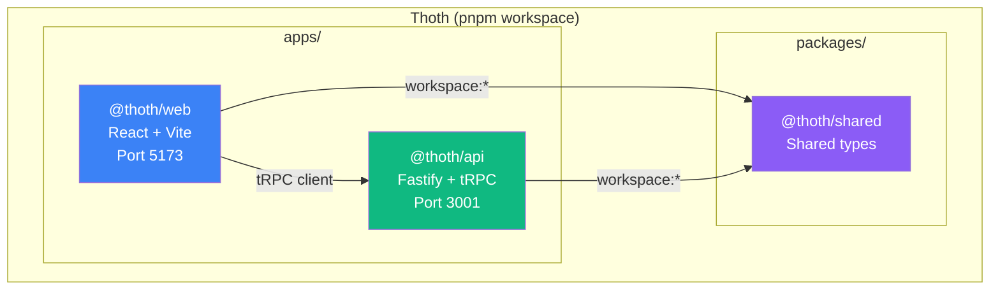
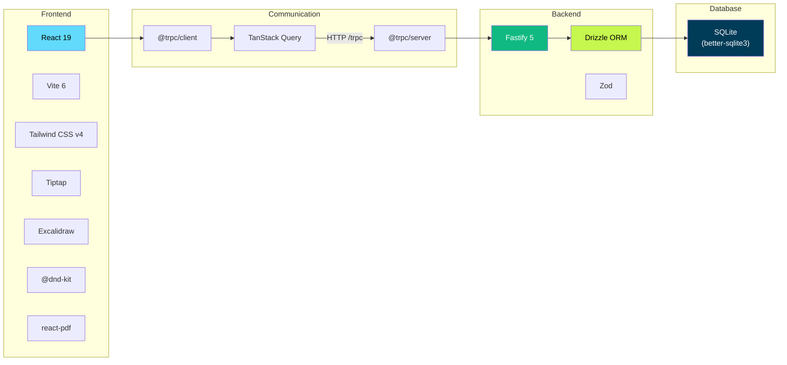

# Thoth

**Personal study tool.** A local application that combines features from Notion, Excalidraw, and Obsidian into a single integrated environment for organizing research, notes, documents, and academic tasks.

## Features

| Feature | Description |
|---|---|
| **Notes** | Rich-text editor with Tiptap (lists, tables, code, images, links) and hierarchical folder organization |
| **Documents/PDFs** | Upload, inline viewing with continuous scroll, text extraction, reading status, general summary, and per-page notes. Folder import via file explorer |
| **Diagrams** | Visual editor with Excalidraw for creating diagrams, flowcharts, and schemas |
| **Tasks/Kanban** | Kanban board with columns (To Do, In Progress, Done), drag-and-drop, priorities, and due dates |
| **Pomodoro** | Built-in timer (25min) that can be linked to tasks for focus tracking |
| **Flashcards SM-2** | Spaced repetition system with SM-2 algorithm for efficient memorization |
| **Tags** | Polymorphic tag system with colors for categorizing notes, documents, diagrams, and tasks |
| **Global Search** | Unified search across notes, documents, diagrams, and tasks (Ctrl+Shift+K) |
| **Links** | Bidirectional connections between any entity in the system |
| **Quick Capture** | Quickly create notes and tasks with Ctrl+Shift+N |

## Architecture

### Monorepo Structure



### Technology Stack



## Prerequisites

- **Node.js** >= 20.0.0
- **pnpm** (package manager)
- **Docker** (optional, for container-based execution)

## Quick Start

### Local Development

```bash
# 1. Clone the repository
git clone <repo-url>
cd thoth

# 2. Install dependencies
pnpm install

# 3. Run database migrations
pnpm db:migrate

# 4. Start in development mode (API + Web simultaneously)
pnpm dev
```

The application will be available at:
- **Frontend:** http://localhost:5173
- **API:** http://localhost:3001

### Docker

```bash
# Build and start
docker compose up -d

# The application will be available at http://localhost:3001
```

The container serves both the API and the built frontend on a single port (3001). Data (SQLite + PDFs) is persisted in the `./data` volume.

## Project Structure

```
thoth/
├── apps/
│   ├── api/                        # Backend (Fastify + tRPC)
│   │   ├── src/
│   │   │   ├── db/
│   │   │   │   ├── schema.ts       # Table definitions (Drizzle)
│   │   │   │   ├── index.ts        # SQLite connection
│   │   │   │   ├── migrate.ts      # Migration script
│   │   │   │   └── migrations/     # Generated SQL files
│   │   │   ├── trpc/
│   │   │   │   ├── router.ts       # Main router
│   │   │   │   ├── trpc.ts         # tRPC configuration
│   │   │   │   ├── context.ts      # Context (db)
│   │   │   │   └── procedures/     # Domain routers
│   │   │   │       ├── notes.ts
│   │   │   │       ├── documents.ts
│   │   │   │       ├── diagrams.ts
│   │   │   │       ├── tasks.ts
│   │   │   │       ├── flashcards.ts
│   │   │   │       ├── tags.ts
│   │   │   │       ├── links.ts
│   │   │   │       ├── search.ts
│   │   │   │       └── health.ts
│   │   │   ├── services/
│   │   │   │   ├── storage.ts      # PDF management
│   │   │   │   └── pdf.ts          # Text extraction
│   │   │   ├── utils/
│   │   │   │   └── id.ts           # ID generation (nanoid)
│   │   │   ├── config.ts           # Configuration
│   │   │   └── index.ts            # Entry point
│   │   └── package.json
│   │
│   └── web/                        # Frontend (React + Vite)
│       ├── src/
│       │   ├── components/
│       │   │   ├── layout/
│       │   │   │   ├── AppShell.tsx
│       │   │   │   ├── Sidebar.tsx
│       │   │   │   └── TopBar.tsx
│       │   │   ├── editor/
│       │   │   │   ├── NoteEditor.tsx
│       │   │   │   └── EditorToolbar.tsx
│       │   │   ├── documents/
│       │   │   │   ├── DocumentViewer.tsx
│       │   │   │   └── DocumentNoteEditor.tsx
│       │   │   ├── diagrams/
│       │   │   │   └── DiagramEditor.tsx
│       │   │   ├── search/
│       │   │   │   └── GlobalSearch.tsx
│       │   │   ├── TagManager.tsx
│       │   │   ├── PomodoroTimer.tsx
│       │   │   └── QuickCapture.tsx
│       │   ├── pages/
│       │   │   ├── DashboardPage.tsx
│       │   │   ├── NotesPage.tsx
│       │   │   ├── DocumentsPage.tsx
│       │   │   ├── DiagramsPage.tsx
│       │   │   ├── TasksPage.tsx
│       │   │   └── FlashcardsPage.tsx
│       │   ├── hooks/
│       │   │   └── useDebounce.ts
│       │   ├── lib/
│       │   │   └── utils.ts
│       │   ├── trpc.ts             # tRPC client
│       │   ├── App.tsx
│       │   ├── main.tsx
│       │   └── app.css             # CSS variables / theme
│       └── package.json
│
├── packages/
│   └── shared/                     # Shared types
│       └── package.json
│
├── package.json                    # Root workspace
├── pnpm-workspace.yaml
├── Dockerfile                     # Multi-stage build
├── docker-compose.yml             # Orchestration
├── .dockerignore
└── CLAUDE.md
```

## Database Schema


## Keyboard Shortcuts

| Shortcut | Action |
|---|---|
| `Ctrl + N` | Quick Capture -- create a quick note |
| `Ctrl + K` | Global Search -- search across the entire system |
