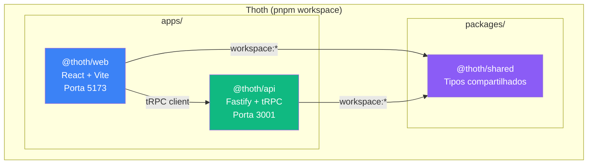
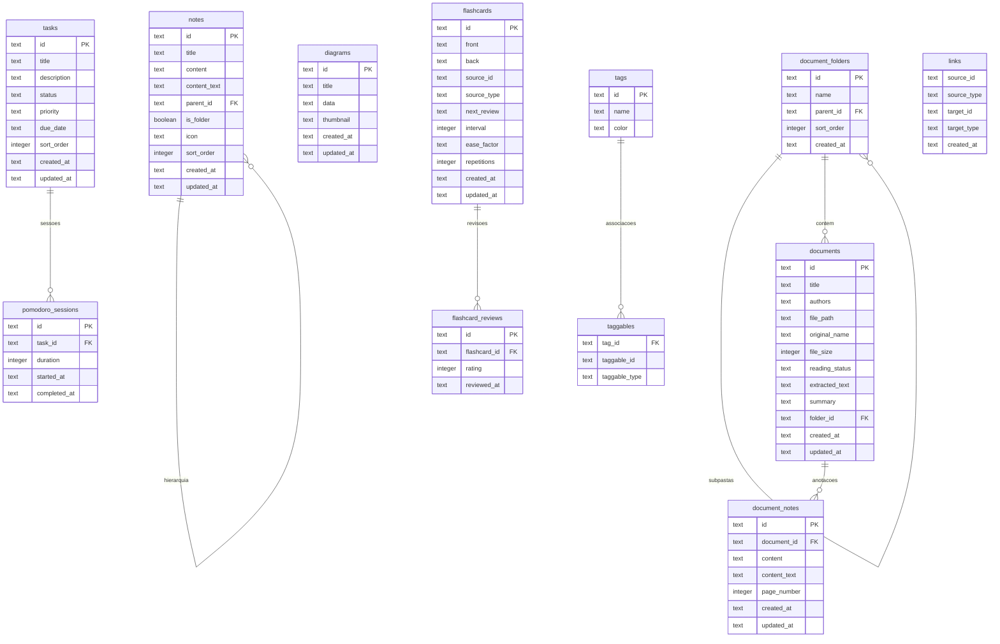

# Thoth

**Ferramenta pessoal de estudos para TCC** -- uma aplicacao local que combina funcionalidades de Notion, Excalidraw e Obsidian em um unico ambiente integrado para organizar pesquisas, anotacoes, documentos e tarefas academicas.

## Funcionalidades

| Funcionalidade | Descricao |
|---|---|
| **Notas** | Editor rich-text com Tiptap (listas, tabelas, codigo, imagens, links) e organizacao hierarquica em pastas |
| **Documentos/PDFs** | Upload, visualizacao inline com scroll continuo, extracao de texto, status de leitura, resumo geral e anotacoes por pagina. Importacao de pastas via explorador de arquivos |
| **Diagramas** | Editor visual com Excalidraw para criar diagramas, fluxogramas e esquemas |
| **Tarefas/Kanban** | Quadro Kanban com colunas (A Fazer, Em Progresso, Concluido), drag-and-drop, prioridades e datas de entrega |
| **Pomodoro** | Timer integrado (25min) vinculavel a tarefas para controle de foco |
| **Flashcards SM-2** | Sistema de repeticao espacada com algoritmo SM-2 para memorizacao eficiente |
| **Tags** | Sistema polimorfico de tags com cores para categorizar notas, documentos, diagramas e tarefas |
| **Busca Global** | Pesquisa unificada em notas, documentos, diagramas e tarefas (Ctrl+Shift+K) |
| **Links** | Conexoes bidirecionais entre qualquer entidade do sistema |
| **Quick Capture** | Criacao rapida de notas e tarefas com Ctrl+Shift+N |

## Arquitetura

### Estrutura do Monorepo



### Stack Tecnologica


## Pre-requisitos

- **Node.js** >= 20.0.0
- **pnpm** (gerenciador de pacotes)
- **Docker** (opcional, para execucao via container)

## Inicio Rapido

### Desenvolvimento local

```bash
# 1. Clonar o repositorio
git clone <repo-url>
cd thoth

# 2. Instalar dependencias
pnpm install

# 3. Executar as migracoes do banco de dados
pnpm db:migrate

# 4. Iniciar em modo de desenvolvimento (API + Web simultaneamente)
pnpm dev
```

A aplicacao estara disponivel em:
- **Frontend:** http://localhost:5173
- **API:** http://localhost:3001

### Docker

```bash
# Construir e iniciar
docker compose up -d

# A aplicacao estara disponivel em http://localhost:3001
```

O container serve tanto a API quanto o frontend buildado em uma unica porta (3001). Os dados (SQLite + PDFs) sao persistidos no volume `./data`.

## Estrutura do Projeto

```
thoth/
├── apps/
│   ├── api/                        # Backend (Fastify + tRPC)
│   │   ├── src/
│   │   │   ├── db/
│   │   │   │   ├── schema.ts       # Definicao das tabelas (Drizzle)
│   │   │   │   ├── index.ts        # Conexao com SQLite
│   │   │   │   ├── migrate.ts      # Script de migracao
│   │   │   │   └── migrations/     # Arquivos SQL gerados
│   │   │   ├── trpc/
│   │   │   │   ├── router.ts       # Router principal
│   │   │   │   ├── trpc.ts         # Configuracao do tRPC
│   │   │   │   ├── context.ts      # Contexto (db)
│   │   │   │   └── procedures/     # Routers por dominio
│   │   │   │       ├── notes.ts
│   │   │   │       ├── documents.ts
│   │   │   │       ├── diagrams.ts
│   │   │   │       ├── tasks.ts
│   │   │   │       ├── flashcards.ts
│   │   │   │       ├── tags.ts
│   │   │   │       ├── links.ts
│   │   │   │       ├── search.ts
│   │   │   │       └── health.ts
│   │   │   ├── services/
│   │   │   │   ├── storage.ts      # Gerenciamento de PDFs
│   │   │   │   └── pdf.ts          # Extracao de texto
│   │   │   ├── utils/
│   │   │   │   └── id.ts           # Geracao de IDs (nanoid)
│   │   │   ├── config.ts           # Configuracoes
│   │   │   └── index.ts            # Entry point
│   │   └── package.json
│   │
│   └── web/                        # Frontend (React + Vite)
│       ├── src/
│       │   ├── components/
│       │   │   ├── layout/
│       │   │   │   ├── AppShell.tsx
│       │   │   │   ├── Sidebar.tsx
│       │   │   │   └── TopBar.tsx
│       │   │   ├── editor/
│       │   │   │   ├── NoteEditor.tsx
│       │   │   │   └── EditorToolbar.tsx
│       │   │   ├── documents/
│       │   │   │   ├── DocumentViewer.tsx
│       │   │   │   └── DocumentNoteEditor.tsx
│       │   │   ├── diagrams/
│       │   │   │   └── DiagramEditor.tsx
│       │   │   ├── search/
│       │   │   │   └── GlobalSearch.tsx
│       │   │   ├── TagManager.tsx
│       │   │   ├── PomodoroTimer.tsx
│       │   │   └── QuickCapture.tsx
│       │   ├── pages/
│       │   │   ├── DashboardPage.tsx
│       │   │   ├── NotesPage.tsx
│       │   │   ├── DocumentsPage.tsx
│       │   │   ├── DiagramsPage.tsx
│       │   │   ├── TasksPage.tsx
│       │   │   └── FlashcardsPage.tsx
│       │   ├── hooks/
│       │   │   └── useDebounce.ts
│       │   ├── lib/
│       │   │   └── utils.ts
│       │   ├── trpc.ts             # Cliente tRPC
│       │   ├── App.tsx
│       │   ├── main.tsx
│       │   └── app.css             # Variaveis CSS / tema
│       └── package.json
│
├── packages/
│   └── shared/                     # Tipos compartilhados
│       └── package.json
│
├── package.json                    # Root workspace
├── pnpm-workspace.yaml
├── Dockerfile                     # Build multi-stage
├── docker-compose.yml             # Orquestracao
├── .dockerignore
└── CLAUDE.md
```

## Esquema do Banco de Dados



## Atalhos de Teclado

| Atalho | Acao |
|---|---|
| `Ctrl + N` | Quick Capture -- criar nota rapida |
| `Ctrl + K` | Busca Global -- pesquisar em todo o sistema |

## Screenshots

> _Secao reservada para capturas de tela da aplicacao._

## Licenca

Projeto pessoal e privado, desenvolvido como ferramenta de apoio ao TCC. Nao destinado a distribuicao ou uso comercial.
