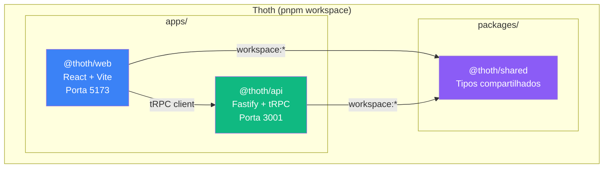
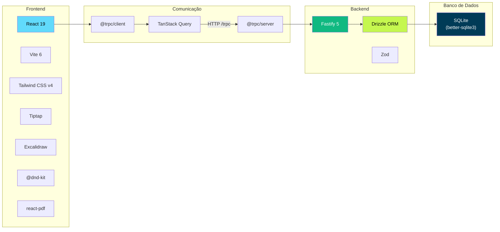

# Thoth

**Ferramenta pessoal de estudos.** Uma aplicação local que combina recursos do Notion, Excalidraw e Obsidian em um único ambiente integrado para organizar pesquisas, anotações, documentos e tarefas acadêmicas.

## Licença e Uso

O uso deste software é **livre para atividades não comerciais**.

Para qualquer uso com **finalidade comercial**, é necessário entrar em contato previamente com a **Universidade Federal de Lavras (UFLA)** para obter autorização.

Os termos completos estão no arquivo [LICENSE](LICENSE).

## Funcionalidades

| Funcionalidade | Descrição |
|---|---|
| **Anotações** | Editor de texto rico com Tiptap (listas, tabelas, código, imagens, links) e organização hierárquica em pastas |
| **Documentos/PDFs** | Upload, visualização integrada com rolagem contínua, extração de texto, status de leitura, resumo geral e anotações por página. Importação de pastas pelo explorador de arquivos |
| **Diagramas** | Editor visual com Excalidraw para criar diagramas, fluxogramas e esquemas |
| **Tarefas/Kanban** | Quadro Kanban com colunas (A Fazer, Em Andamento, Concluído), arrastar e soltar, prioridades e prazos |
| **Pomodoro** | Temporizador integrado (25min) que pode ser vinculado a tarefas para acompanhamento de foco |
| **Flashcards SM-2** | Sistema de repetição espaçada com o algoritmo SM-2 para memorização eficiente |
| **Tags** | Sistema polimórfico de tags com cores para categorizar anotações, documentos, diagramas e tarefas |
| **Busca Global** | Busca unificada em anotações, documentos, diagramas e tarefas (Ctrl+Shift+K) |
| **Vínculos** | Conexões bidirecionais entre quaisquer entidades do sistema |
| **Captura Rápida** | Criação rápida de anotações e tarefas com Ctrl+Shift+N |

## Arquitetura

### Estrutura do Monorepo



### Stack Tecnológica



## Pré-requisitos

- **Node.js** >= 20.0.0
- **pnpm** (gerenciador de pacotes)
- **Docker** (opcional, para execução em contêiner)

## Início Rápido

### Desenvolvimento Local

```bash
# 1. Clone o repositório
git clone <repo-url>
cd thoth

# 2. Instale as dependências
pnpm install

# 3. Execute as migrações do banco de dados
pnpm db:migrate

# 4. Inicie em modo de desenvolvimento (API + Web simultaneamente)
pnpm dev
```

A aplicação estará disponível em:
- **Frontend:** http://localhost:5173
- **API:** http://localhost:3001

### Docker

```bash
# Build e inicialização
docker compose up -d

# A aplicação estará disponível em http://localhost:3001
```

O contêiner serve tanto a API quanto o frontend compilado em uma única porta (3001). Os dados (SQLite + PDFs) são persistidos no volume `./data`.

## Estrutura do Projeto

```
thoth/
├── apps/
│   ├── api/                        # Backend (Fastify + tRPC)
│   │   ├── src/
│   │   │   ├── db/
│   │   │   │   ├── schema.ts       # Definição das tabelas (Drizzle)
│   │   │   │   ├── index.ts        # Conexão com o SQLite
│   │   │   │   ├── migrate.ts      # Script de migração
│   │   │   │   └── migrations/     # Arquivos SQL gerados
│   │   │   ├── trpc/
│   │   │   │   ├── router.ts       # Router principal
│   │   │   │   ├── trpc.ts         # Configuração do tRPC
│   │   │   │   ├── context.ts      # Contexto (db)
│   │   │   │   └── procedures/     # Routers por domínio
│   │   │   │       ├── notes.ts
│   │   │   │       ├── documents.ts
│   │   │   │       ├── diagrams.ts
│   │   │   │       ├── tasks.ts
│   │   │   │       ├── flashcards.ts
│   │   │   │       ├── tags.ts
│   │   │   │       ├── links.ts
│   │   │   │       ├── search.ts
│   │   │   │       └── health.ts
│   │   │   ├── services/
│   │   │   │   ├── storage.ts      # Gerenciamento de PDFs
│   │   │   │   └── pdf.ts          # Extração de texto
│   │   │   ├── utils/
│   │   │   │   └── id.ts           # Geração de IDs (nanoid)
│   │   │   ├── config.ts           # Configuração
│   │   │   └── index.ts            # Ponto de entrada
│   │   └── package.json
│   │
│   └── web/                        # Frontend (React + Vite)
│       ├── src/
│       │   ├── components/
│       │   │   ├── layout/
│       │   │   │   ├── AppShell.tsx
│       │   │   │   ├── Sidebar.tsx
│       │   │   │   └── TopBar.tsx
│       │   │   ├── editor/
│       │   │   │   ├── NoteEditor.tsx
│       │   │   │   └── EditorToolbar.tsx
│       │   │   ├── documents/
│       │   │   │   ├── DocumentViewer.tsx
│       │   │   │   └── DocumentNoteEditor.tsx
│       │   │   ├── diagrams/
│       │   │   │   └── DiagramEditor.tsx
│       │   │   ├── search/
│       │   │   │   └── GlobalSearch.tsx
│       │   │   ├── TagManager.tsx
│       │   │   ├── PomodoroTimer.tsx
│       │   │   └── QuickCapture.tsx
│       │   ├── pages/
│       │   │   ├── DashboardPage.tsx
│       │   │   ├── NotesPage.tsx
│       │   │   ├── DocumentsPage.tsx
│       │   │   ├── DiagramsPage.tsx
│       │   │   ├── TasksPage.tsx
│       │   │   └── FlashcardsPage.tsx
│       │   ├── hooks/
│       │   │   └── useDebounce.ts
│       │   ├── lib/
│       │   │   └── utils.ts
│       │   ├── trpc.ts             # Cliente tRPC
│       │   ├── App.tsx
│       │   ├── main.tsx
│       │   └── app.css             # Variáveis CSS / tema
│       └── package.json
│
├── packages/
│   └── shared/                     # Tipos compartilhados
│       └── package.json
│
├── package.json                    # Workspace raiz
├── pnpm-workspace.yaml
├── Dockerfile                     # Build multi-stage
├── docker-compose.yml             # Orquestração
├── .dockerignore
└── CLAUDE.md
```

## Esquema do Banco de Dados


## Atalhos de Teclado

| Atalho | Ação |
|---|---|
| `Ctrl + Shift + N` | Captura Rápida: cria uma anotação rápida |
| `Ctrl + Shift + K` | Busca Global: pesquisa em todo o sistema |
