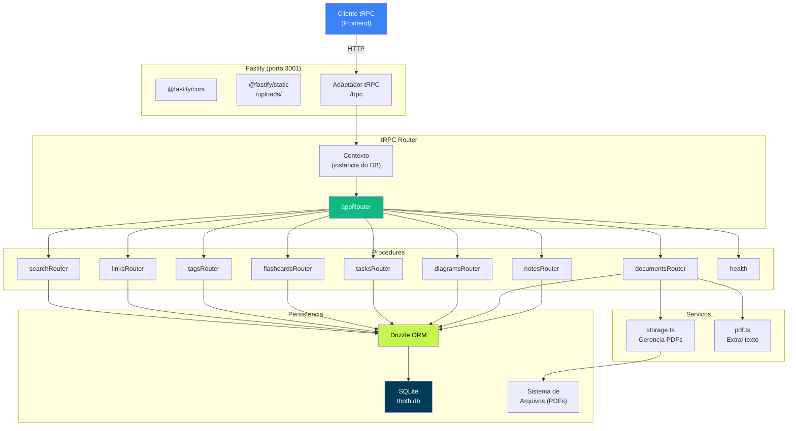
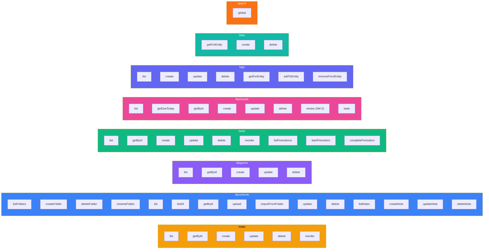
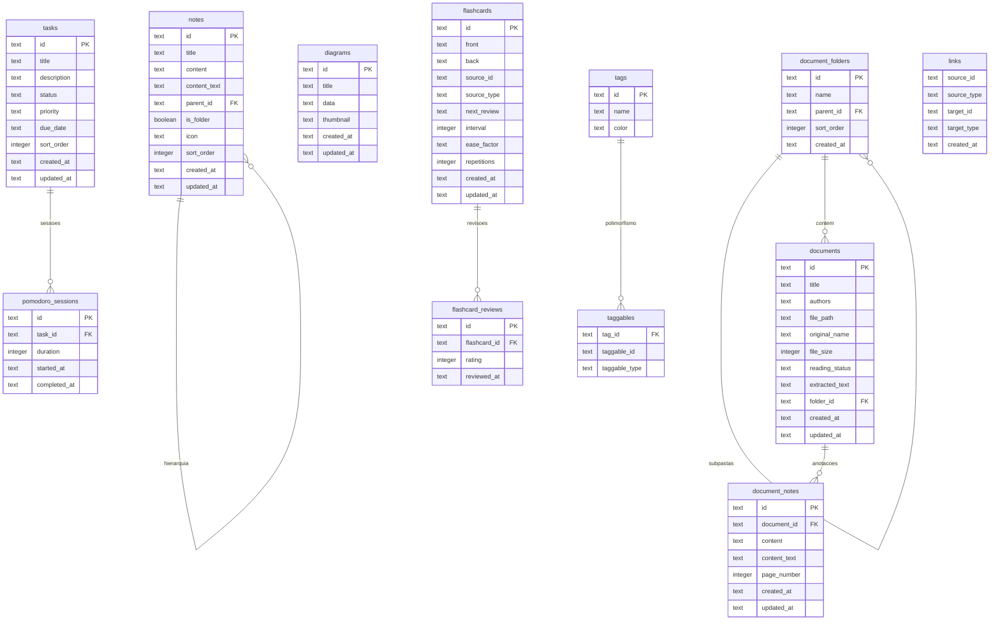

# Thoth API

Backend da aplicacao Thoth, construido com **Fastify**, **tRPC**, **Drizzle ORM** e **SQLite** (via better-sqlite3). Responsavel por toda a logica de negocio, persistencia de dados e servicos de arquivos.

## Arquitetura da API



## Routers e Procedures



## Banco de Dados

O Thoth utiliza **SQLite** como banco de dados, gerenciado pelo **Drizzle ORM**. O arquivo do banco (`thoth.db`) e criado automaticamente na raiz do projeto.

### Diagrama ER



### Migracoes

As migracoes sao geradas pelo Drizzle Kit e ficam em `src/db/migrations/`. Para gerencia-las:

```bash
# Gerar nova migracao a partir de alteracoes no schema.ts
pnpm db:generate

# Aplicar migracoes pendentes
pnpm db:migrate
```

## Estrutura de Arquivos

```
apps/api/src/
├── config.ts                  # Porta, host, caminhos de diretorio
├── index.ts                   # Entry point -- inicializa Fastify
├── db/
│   ├── schema.ts              # Definicao de todas as tabelas
│   ├── index.ts               # Cria conexao better-sqlite3 + Drizzle
│   ├── migrate.ts             # Script para aplicar migracoes
│   └── migrations/            # SQL gerado pelo Drizzle Kit
├── trpc/
│   ├── trpc.ts                # initTRPC, publicProcedure
│   ├── context.ts             # createContext (injeta db)
│   ├── router.ts              # appRouter -- combina sub-routers
│   └── procedures/
│       ├── health.ts          # Healthcheck simples
│       ├── notes.ts           # CRUD + reorder de notas hierarquicas
│       ├── documents.ts       # CRUD + upload + import + notas de documentos
│       ├── diagrams.ts        # CRUD de diagramas (dados Excalidraw)
│       ├── tasks.ts           # CRUD + reorder + pomodoro
│       ├── flashcards.ts      # CRUD + review SM-2 + stats
│       ├── tags.ts            # CRUD + associacoes polimorfica
│       ├── links.ts           # Links bidirecionais entre entidades
│       └── search.ts          # Busca global (LIKE em titulo/conteudo)
├── services/
│   ├── storage.ts             # savePdf, deletePdf, importFolder
│   └── pdf.ts                 # extractTextFromPdf (via pdf-parse)
└── utils/
    └── id.ts                  # generateId (nanoid), now (ISO timestamp)
```

## Como Executar

```bash
# Desenvolvimento (com hot-reload via tsx watch)
pnpm dev

# Build
pnpm build

# Producao
pnpm start
```

O servidor inicia na **porta 3001** por padrao.

## Endpoints

Todas as chamadas sao feitas via tRPC no caminho `/trpc`. Nao existem endpoints REST tradicionais.

Alem disso, arquivos estaticos (PDFs enviados) sao servidos em `/uploads/` via `@fastify/static`.

### Exemplos de chamadas tRPC

| Procedure | Tipo | Descricao |
|---|---|---|
| `notes.list` | Query | Lista notas (opcionalmente por parentId) |
| `notes.create` | Mutation | Cria nota ou pasta |
| `documents.upload` | Mutation | Upload de PDF (base64), extrai texto |
| `documents.importFromFolder` | Mutation | Importa todos os PDFs de um diretorio local |
| `tasks.reorder` | Mutation | Reordena tarefas entre colunas do Kanban |
| `tasks.startPomodoro` | Mutation | Inicia sessao Pomodoro (padrao: 25min) |
| `flashcards.review` | Mutation | Aplica algoritmo SM-2 e agenda proxima revisao |
| `flashcards.getDueToday` | Query | Retorna flashcards pendentes para hoje |
| `tags.addToEntity` | Mutation | Associa tag a nota/documento/diagrama/tarefa |
| `links.create` | Mutation | Cria link bidirecional entre duas entidades |
| `search.global` | Query | Busca por texto em notas, documentos, diagramas e tarefas |

## Servicos

### storage.ts

Gerencia o armazenamento de arquivos PDF no sistema de arquivos local:
- **`savePdf(buffer, fileName)`** -- salva o buffer como arquivo PDF, retorna o caminho
- **`deletePdf(filePath)`** -- remove o arquivo do disco
- **`importFolder(folderPath)`** -- le todos os `.pdf` de uma pasta local

### pdf.ts

- **`extractTextFromPdf(buffer)`** -- utiliza a biblioteca `pdf-parse` para extrair texto de um PDF, permitindo busca no conteudo dos documentos

## Algoritmo SM-2 (Flashcards)

O sistema de flashcards implementa o algoritmo **SuperMemo 2 (SM-2)** para repeticao espacada:

1. O usuario avalia seu desempenho com uma nota de **0 a 5**
2. Se a nota for **< 3**: o cartao e reiniciado (repeticoes = 0, intervalo = 1 dia)
3. Se a nota for **>= 3**: o intervalo cresce progressivamente:
   - 1a repeticao: 1 dia
   - 2a repeticao: 6 dias
   - Repeticoes seguintes: `intervalo_anterior * fator_facilidade`
4. O **fator de facilidade** (EF) e ajustado a cada revisao, com minimo de 1.3
5. A **proxima revisao** e calculada somando o intervalo a data atual

Isso garante que cartoes mais dificeis sejam revisados com mais frequencia, enquanto cartoes faceis espacam cada vez mais.
