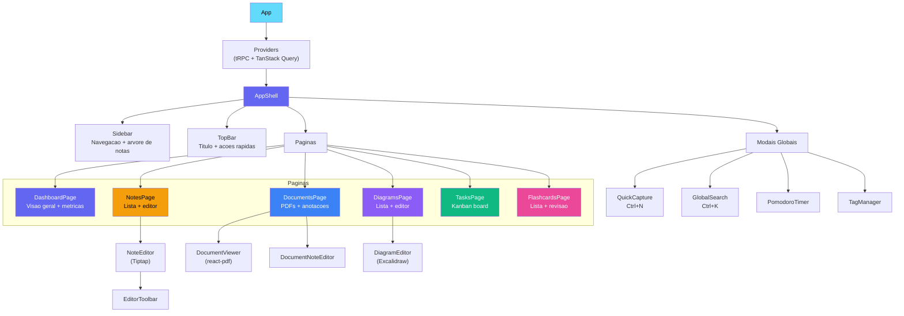
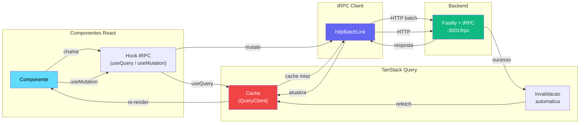

# Thoth Web

Frontend da aplicacao Thoth, construido com **React 19**, **Vite 6** e **Tailwind CSS v4**. Interface visual colorida e responsiva para gerenciar notas, documentos, diagramas, tarefas e flashcards.

## Hierarquia de Componentes



## Fluxo de Estado e Dados



## Paginas e Funcionalidades

### DashboardPage
- Visao geral do sistema com metricas e acessos rapidos
- Contadores de notas, documentos, tarefas e flashcards pendentes
- Navegacao direta para cada secao

### NotesPage
- **Arvore hierarquica** de notas e pastas na sidebar
- **Editor rich-text** com Tiptap (negrito, italico, sublinhado, titulos, listas, tabelas, blocos de codigo com syntax highlighting, imagens, links, tarefas)
- **EditorToolbar** com botoes de formatacao
- Organizacao por pastas com drag-and-drop
- Auto-save com debounce

### DocumentsPage
- Upload de PDFs (arrastar ou selecionar)
- Importacao em lote de uma pasta local
- **Visualizador de PDF** inline com react-pdf
- Status de leitura: Nao Lido, Para Ler, Lendo, Lido
- Organizacao em pastas
- **Anotacoes por pagina** com editor rich-text vinculado ao documento

### DiagramsPage
- Lista de diagramas com thumbnails
- **Editor de diagramas** completo com Excalidraw
- Suporte a formas, setas, texto livre, desenho a mao
- Salvamento automatico dos dados do diagrama

### TasksPage
- **Quadro Kanban** com 3 colunas: A Fazer, Em Progresso, Concluido
- **Drag-and-drop** entre colunas com @dnd-kit
- Prioridades (baixa, media, alta) com indicacao visual
- Data de entrega
- Descricao detalhada por tarefa

### FlashcardsPage
- Criacao de cartoes com frente e verso
- **Modo de revisao** com algoritmo SM-2
- Avaliacao de 0 a 5 apos revelar resposta
- Estatisticas: total de cartoes, pendentes hoje, revisados hoje
- Vinculacao a notas ou documentos como fonte

## Estrutura de Componentes

```
src/
├── components/
│   ├── layout/
│   │   ├── AppShell.tsx          # Shell principal (gerencia paginas, atalhos, modais)
│   │   ├── Sidebar.tsx           # Navegacao lateral + arvore de notas
│   │   └── TopBar.tsx            # Barra superior (titulo, acoes, pomodoro)
│   ├── editor/
│   │   ├── NoteEditor.tsx        # Editor Tiptap configurado com extensoes
│   │   └── EditorToolbar.tsx     # Barra de formatacao do editor
│   ├── documents/
│   │   ├── DocumentViewer.tsx    # Visualizador de PDF com react-pdf
│   │   └── DocumentNoteEditor.tsx # Editor de anotacoes de documento
│   ├── diagrams/
│   │   └── DiagramEditor.tsx     # Wrapper do Excalidraw
│   ├── search/
│   │   └── GlobalSearch.tsx      # Modal de busca global (Ctrl+K)
│   ├── TagManager.tsx            # Gerenciamento de tags em entidades
│   ├── PomodoroTimer.tsx         # Timer Pomodoro (25min padrao)
│   └── QuickCapture.tsx          # Modal de captura rapida (Ctrl+N)
├── pages/
│   ├── DashboardPage.tsx         # Pagina inicial / visao geral
│   ├── NotesPage.tsx             # Notas com editor
│   ├── DocumentsPage.tsx         # Gerenciamento de PDFs
│   ├── DiagramsPage.tsx          # Diagramas com Excalidraw
│   ├── TasksPage.tsx             # Kanban de tarefas
│   └── FlashcardsPage.tsx        # Flashcards com SM-2
├── hooks/
│   └── useDebounce.ts            # Hook de debounce (usado no auto-save)
├── lib/
│   └── utils.ts                  # Utilitarios (clsx, tailwind-merge)
├── trpc.ts                       # Configuracao do cliente tRPC
├── App.tsx                       # Root component com providers
├── main.tsx                      # Entry point (ReactDOM)
└── app.css                       # Variaveis CSS e tema global
```

## Bibliotecas Principais

| Biblioteca | Uso |
|---|---|
| **Tiptap** | Editor rich-text extensivel (StarterKit + extensoes para tabelas, tarefas, codigo, imagens, links, tipografia) |
| **Excalidraw** | Editor de diagramas e desenhos vetoriais |
| **react-pdf** | Renderizacao de PDFs diretamente no navegador |
| **@dnd-kit** | Sistema de drag-and-drop (core + sortable) para Kanban e reordenacao |
| **lucide-react** | Biblioteca de icones consistentes |
| **TanStack Query** | Cache e sincronizacao de dados do servidor |
| **@trpc/react-query** | Integracao type-safe entre tRPC e TanStack Query |
| **clsx + tailwind-merge** | Composicao condicional de classes CSS |
| **lowlight** | Syntax highlighting para blocos de codigo no editor |
| **react-router** | Roteamento (disponivel para uso futuro) |

## Sistema de Cores (CSS Custom Properties)

O tema visual e definido por variaveis CSS em `app.css`, facilitando customizacao:

```css
/* Paleta primaria */
--color-primary: #6366f1       /* Indigo -- cor principal */
--color-primary-light: #818cf8
--color-primary-dark: #4f46e5

/* Cores por entidade */
--color-notes: #f59e0b        /* Amber -- notas */
--color-documents: #3b82f6    /* Blue -- documentos */
--color-diagrams: #8b5cf6     /* Violet -- diagramas */
--color-tasks: #10b981        /* Emerald -- tarefas */
--color-flashcards: #ec4899   /* Pink -- flashcards */

/* Fundos */
--color-bg: #fafbfc           /* Fundo principal */
--color-bg-sidebar: #f1f3f9   /* Fundo da sidebar */
--color-bg-card: #ffffff      /* Fundo de cards */

/* Texto */
--color-text: #1e293b         /* Texto principal */
--color-text-secondary: #64748b
--color-text-muted: #94a3b8

/* Status */
--color-success: #10b981
--color-warning: #f59e0b
--color-error: #ef4444
--color-info: #3b82f6
```

Cada secao da aplicacao utiliza sua cor tematica para diferenciar visualmente os modulos.

## Como Executar

```bash
# Desenvolvimento (com hot-reload via Vite)
pnpm dev

# Build para producao
pnpm build

# Preview do build
pnpm preview
```

O servidor de desenvolvimento inicia na **porta 5173** por padrao.

> **Nota:** O frontend depende da API rodando em `localhost:3001`. Use `pnpm dev` na raiz do monorepo para iniciar ambos simultaneamente.
